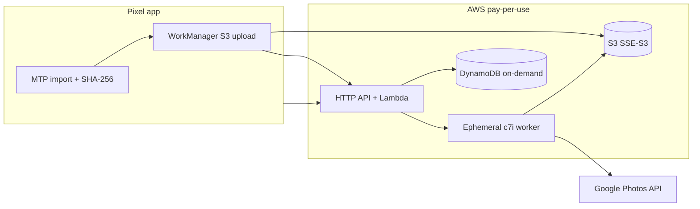

# Photo Pipeline

Canon EOS R8 → Pixel 9 Pro → S3 → ephemeral EC2 (LightCraft) → Google Photos.

Personal, multi-user (owner + friends/family), **near-zero idle AWS cost**. Each user links their own Google account; RAW originals land in encrypted S3; one spot/on-demand **c7i** worker per completed shoot processes CR3s headlessly and publishes JPEGs to an **app-created** Google Photos album.

## Architecture



**Why AWS CDK (TypeScript)?** The stack is AWS-native (HTTP API, Lambda, Cognito basic pool, DynamoDB, S3, EventBridge, EC2 run-instances). CDK gives typed IAM, `cdk synth` validation without deploying, and keeps Lambda + infra in one repo. Terraform would work; CDK is less boilerplate for Node Lambdas and bundling.

### Idle cost (excluding stored photos)

| Resource | Idle charge |
|----------|-------------|
| HTTP API | $0 (pay per request) |
| Lambda | $0 |
| DynamoDB on-demand | $0 (no storage → no cost; pennies at this scale) |
| S3 empty bucket | ~$0 |
| SSM SecureString | ~$0 (Standard parameters; no per-secret $0.40/mo) |
| Cognito basic user pool | $0 MAU for small personal use |
| EC2 | $0 (only when processing) |
| EventBridge hourly watchdog | ~$0.001/mo |
| CloudWatch Logs | Cents if unused; **7-day retention** on Lambdas |

**Expected idle total: ~$0–0.05/mo** until you store RAWs/JPEGs or run shoots. A 500-image shoot might land around **~$1** all-in (see `config/pricing.json` and `/shoots/estimate`).

**Deliberately omitted:** NAT gateway, ALB, always-on EC2, interface VPC endpoints, custom KMS ($1/mo/key), Secrets Manager per-user secrets ($0.40/mo each). Google refresh tokens live in **SSM SecureString** (default AWS-managed key).

## Repo layout

| Path | Purpose |
|------|---------|
| `android/` | Kotlin / Compose / Room / WorkManager app |
| `infra/` | AWS CDK stack + Lambda handlers |
| `worker/` | EC2 worker (LightCraft + GPhotos) |
| `gphotos/` | Google Photos uploader (from feasibility study) |
| `lib/photopipeline/` | Shared manifest, state machine, pricing |
| `config/pricing.json` | Configurable pricing table for estimates |

## Deploy (not run in CI — no real credentials)

1. **Google Cloud:** Follow `gphotos/SETUP.md` — Photos Library API, OAuth client (Web type for redirect), testers, scopes `appendonly` + `readonly.appcreateddata`.
2. **AWS:** `cd infra && npm install && npx cdk bootstrap && npx cdk deploy`
   - Set parameters **`WorkerVpcId`** and **`WorkerPublicSubnetId`** to your **default VPC** public subnet (worker needs outbound internet; **no inbound** SG rules).
   - Put OAuth client JSON in SSM **`/photopipeline/google-oauth-client`** (SecureString).
   - Create Cognito users for the app; configure Android with HTTP API URL + client ID.
3. **Worker AMI:** Bake Amazon Linux 2023 with `lightcraft-cli` (pin commit from feasibility report), Python worker under `/opt/photopipeline/worker`, then point user-data at `python3 -m worker.main`.

## API highlights

- `POST /shoots/estimate` — cost & duration from `config/pricing.json` (auth required).
- `GET /pricing` — public pricing table JSON.
- `POST /shoots`, `POST /shoots/{id}/presign` — multipart presigns.
- `POST /shoots/{id}/finalize` — verify manifest, launch EC2 (spot → on-demand fallback).
- `GET /shoots/{id}/status` — shoot phase, per-file states, actual compute cost after done.
- `GET /oauth/photos/start?userId=` — link Google Photos refresh token (stored in SSM).

## Android app

- Google Photos linking via backend OAuth (refresh token on server).
- USB host / MTP (Canon vendor `0x04A9`); `MockMtpRepository` for tests, `CanonMtpRepository` stub for hardware.
- Dedupe key: storage + handle + size + capture time + SHA-256.
- WorkManager foreground uploads with per-file progress, retry, Room persistence.
- **Before submit:** cost estimate from backend; **after processing:** actual compute time & cost from status poll (survives app restart).

## Tests & CI

```bash
cd lib && pytest
cd worker && PYTHONPATH=. pytest
PYTHONPATH=lib pytest backend/tests
cd infra && npm test && npx cdk synth
cd android && ./gradlew assembleDebug test
```

GitHub Actions: `.github/workflows/ci.yml`.

## Verified vs untested

| Area | Status |
|------|--------|
| LightCraft on Linux, R8 corpus tests, CLI flags | **Verified** in feasibility study (`docs/REPORT.md` — copy from upload) |
| Google Photos API behavior | **Documented**, uploader not live-tested |
| This repo: CDK synth, unit/moto tests, Android build | **Verified** in CI |
| Real Canon R8 + Pixel 9 Pro USB | **Not tested** |
| Real AWS deploy, EC2 AMI, end-to-end shoot | **Not tested** |
| Real Google account album creation | **Not tested** |

## Cost estimate endpoint

Example body:

```json
{ "imageCount": 120, "totalBytesRaw": 12000000000 }
```

Returns compute (spot c7i), processing minutes, S3 Standard first-month storage, and total shoot USD — same logic in `lib/photopipeline/pricing.py` and `infra/lambda/pricing.ts`.

## Feasibility reference

See uploaded feasibility report for LightCraft (`longEdge=0`, as-shot WB, `previewOnly` check), Google Photos limits (batch 50, 429 backoff, Testing-mode 7-day tokens), canon-mtp-direct notes, and the shoot/image state machine.
